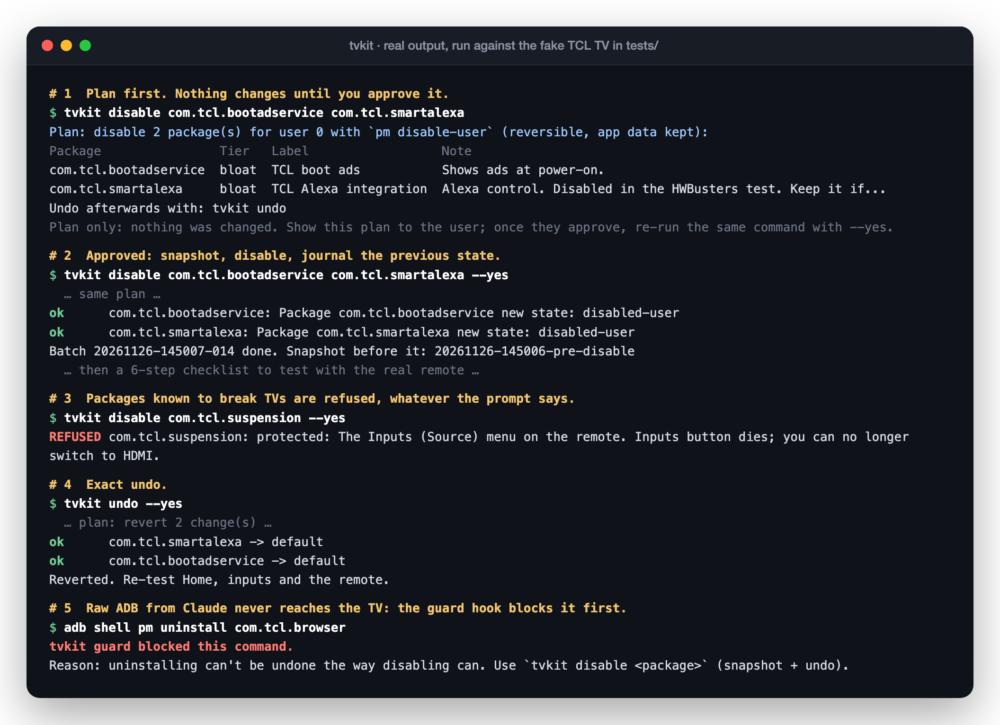
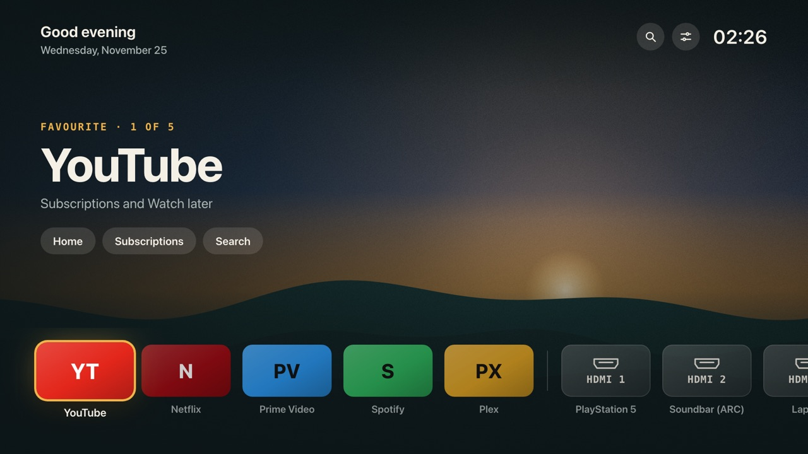
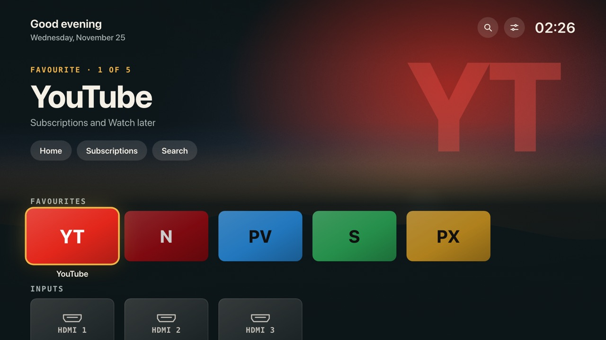
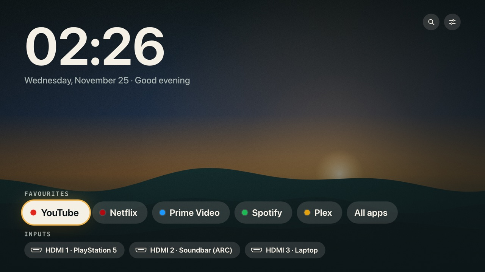

# tvdetox

[](https://github.com/rafaykek/tvdetox/actions/workflows/ci.yml) [](LICENSE)

**Make your Android TV or Google TV faster, cleaner and yours by talking to Claude Code, without breaking it.**

tvdetox ships **tvkit**, a Claude Code plugin for TCL and other Android TV / Google TV sets: seven skills, a safety hook and a small CLI. It connects over Wi-Fi ADB, shows you what's really on the TV, removes ads and bloat in small tested batches, measures speed before and after, designs a new home screen with you, and can undo every change it makes.

> Built and tested on a TCL Android TV (Android 9, 2 GB RAM). No root, no firmware changes, nothing uninstalled.



<sub>Real output from tvkit and the guard hook, run against the fake TCL TV in [`tests/`](tests/). Repeated lines are trimmed and marked with "…".</sub>

## Why another TV debloater?

In October 2026 a TCL Google TV owner handed the remote to Claude Code. They disabled 25 preinstalled apps and built a new launcher in an afternoon. Open-source prompts like CleanYourTV took off soon after. Two things went wrong along the way:

- **TVs broke.** People reported that disabling the wrong package kills the Inputs button (`com.tcl.suspension`), drops Wi-Fi (`com.tcl.providers.config`) or boot-loops the TV (`com.android.location.fused`). Over Wi-Fi ADB, a TV that can't boot can't be reached either.
- **"10x faster" didn't hold up under a stopwatch.** [HWBusters](https://hwbusters.com/software/ai-tv-debloating-tcl-98c7k-benchmarks/) benchmarked a TCL 98C7K before and after a debloat: app launch times moved by 0.5–1.5%.

tvkit keeps the good part, an AI that knows ADB and does the tedious work. It adds the engineering: guardrails, exact undo, and real measurements.

## What's inside

| Skill | What it does | Changes the TV? |
|---|---|---|
| `/tvkit:connect` | Finds the TV on your network, walks you through Developer options and pairing, saves a baseline snapshot | No |
| `/tvkit:audit` | Health check, plus every installed package classified (protected / caution / bloat / optional / unknown) with sources | No |
| `/tvkit:debloat` | Disables ads, promo apps and telemetry in batches of 5 or fewer, which you test in between | Yes, reversibly |
| `/tvkit:speedup` | Benchmarks, applies only the fixes your numbers justify, benchmarks again | Yes, reversibly |
| `/tvkit:redesign` | Screenshots your home screen and designs a modern, personal one as an interactive mockup, then can install it as your real Home screen (tvkit Home) | Only if you choose tvkit Home |
| `/tvkit:remote` | "Open YouTube and search lo-fi": Claude looks at the screen and drives the remote | No settings |
| `/tvkit:restore` | Undoes the last batch or everything, or returns to any snapshot. Includes an emergency playbook. | Yes, restores |

Plus:
- **[`bin/tvkit`](bin/tvkit)**: the CLI every skill goes through. A single Python file using only the standard library, readable in an evening.
- **[`hooks/adb_guard.py`](hooks/adb_guard.py)**: a Claude Code hook that blocks destructive commands before they reach the TV. It covers `pm uninstall`, `fastboot`, `settings put global adb_enabled 0`, factory resets, `rm` outside tvkit's temp files, interactive shells that would hang the session, and more.
- **[`data/packages.json`](data/packages.json)**: a knowledge base of TCL and Google TV packages. Every rating cites its source.

### Preview: `/tvkit:redesign`

Sample data. The skill builds these from your own apps and inputs, as a page you can drive with the arrow keys like a remote:

| Ribbon | Shelf | Minimal |
|---|---|---|
|  |  |  |

### tvkit Home: the mockup becomes your real home screen

The stock Android TV home can't be restyled. It only lets you reorder apps and hide rows. So tvkit can turn your redesign into a launcher:
- [`launcher/`](launcher/) builds a ~200 KB app: a full-screen WebView showing your page, plus a tiny bridge to open apps and HDMI inputs. Network access is blocked.
- Every installed app you didn't put on the ribbon shows up under "More apps", with its real TV banner.

```bash
launcher/build.sh ~/.tvkit/redesign/<date>/tv-redesign.html     # needs a JDK + Android build-tools (no Gradle)
adb install -r ~/.tvkit/launcher/tvkit-home.apk
tvkit home swap dev.tvkit.home    # makes it Home; verifies the Home button; rolls back by itself if not
tvkit undo                        # back to the stock home
```

Why `swap`: the stock launcher registers for Home at intent priority 2, and installed apps are capped at 0, so Android ignores your "default Home" choice. On our TCL, `set-home-activity` printed Success and changed nothing. The only reversible fix is switching the stock launcher off, so `swap` checks the result and undoes itself if the Home button doesn't land on tvkit Home.

## How it keeps your TV safe


1. **Plan before change.** Every command that changes something prints a plan and does nothing until it's re-run with `--yes`. The skills only do that after you say yes.
2. **Snapshot before every change**: all package states, all settings and the system properties.
3. **A protected list built from real breakage reports**, each entry citing its source.
4. **Live checks on the TV itself.** Whatever the list says, tvkit never disables the current Home app, the active keyboard, accessibility services, packages that run as a system user (uid < 10000) or persistent packages.
5. **Disable, never uninstall.** tvkit only uses `pm disable-user`, and app data stays in place.
6. **Exact undo.** Every change is logged with its previous state, and `tvkit undo` restores exactly that. It doesn't just "enable everything".
7. **Small batches and a test checklist** between them: Home, Inputs/HDMI, volume, voice, Wi-Fi, playback.
8. **The guard hook** blocks destructive raw ADB commands, even if a skill or a prompt goes wrong.

Details: [docs/SAFETY.md](docs/SAFETY.md).

## What actually makes a TV faster

| Fix | Evidence | tvkit |
|---|---|---|
| Give it ~10 minutes after powering on from fully off | Measured with tvkit on our TCL: during post-boot app updates (Play Store plus `dex2oat` compiling, 65% CPU), app launches took 1.8–2.5 s. Once settled: 0.97–1.0 s. Debloating changed nothing measurable. | `tvkit bench` |
| Free up storage when it's nearly full | Android TVs slow down sharply with only 1–2 GB free | `tvkit cache` (refuses when storage is fine) |
| Restart after weeks of uptime | TCL's "instant power on" rarely truly reboots. HWBusters' TV had been up 51 days. | `tvkit reboot` |
| 0.5x animations | Felt rather than measured: menus feel snappier | `tvkit animations 0.5` |
| A lighter home screen | Fewer rows and ads to load. But HWBusters measured Projectivy using more idle CPU than the stock home screen. | `/tvkit:redesign` |
| Fewer background apps | Matters on TVs with 1.5–2 GB RAM. About 1% on a flagship. | `/tvkit:debloat` |
| "Booster" apps, clearing caches on a healthy TV | Make things worse | Not offered |

`/tvkit:speedup` measures cold app launch times (`am start -W`), idle CPU and memory before and after, and tells you honestly if nothing changed.

## Quick start

You need Claude Code, Python 3.8+, `adb`, and an Android TV or Google TV on the same network.

```bash
# 1. adb
brew install --cask android-platform-tools   # macOS (Linux: sudo apt install adb)

# 2. tvdetox (the tvkit plugin)
git clone https://github.com/rafaykek/tvdetox && cd tvdetox
claude --plugin-dir .                         # loads the plugin for this session
```

Or install it as a plugin, from inside Claude Code:

```
/plugin marketplace add rafaykek/tvdetox
/plugin install tvkit@tvkit
```

3. On the TV: Settings → System → About. Highlight **Android TV OS build** and press OK 7 times. Then open Developer options and turn on **USB debugging**.
4. In Claude Code, run `/tvkit:connect`, then `/tvkit:audit`.

## The CLI

```
tvkit doctor | discover [--scan] | connect <ip> | pair <ip:port> <code> | status | info
tvkit audit [--json] | explain <pkg> | apps | home
tvkit disable <pkg...> | enable <pkg...> | undo [--all] | restore [snapshot] | journal | snapshots
tvkit animations 0.5 | cache | reboot | set/unset <namespace> <key> [value]
tvkit bench --label before | bench-compare before after
tvkit screenshot | ui-dump | key HOME | text "..." | launch <pkg> | push-wallpaper <png>
tvkit lock        # turn debugging off when you're done
```

Exit codes: `0` ok, `1` error, `2` plan only (re-run with `--yes`), `3` refused by a safety rule. State lives in `~/.tvkit/`: snapshots, the change log, benchmarks and screenshots, all on your computer.

## Supported TVs

| | |
|---|---|
| Tested | TCL Android TV 9 ("BeyondTV" platform, Realtek chipset, 2 GB RAM) |
| Should work | Other TCL, Hisense, Sony, Philips and Xiaomi Android TV and Google TV sets; Chromecast with Google TV |
| Won't work | TCL Roku TV, Samsung (Tizen), LG (webOS): no ADB. Fire TV only partly. |

## Development

```bash
python3 -m unittest discover -s tests -v   # runs against a fake TCL TV, no hardware needed
claude plugin validate .
```

Adding a package to the knowledge base? Cite a source in `src`: a breakage report or a measured test.

## Prior art and credits

- [CleanYourTV](https://github.com/Gathin23/cleanyourtv) and [tv-vibehack](https://github.com/Gathin23/tv-vibehack) by Gathin23: the prompts that started the wave
- [tv-home](https://github.com/mihirgupta0900/tv-home) by Mihir Gupta: the TCL owner who built an Apple TV-style launcher with Claude Code
- [HWBusters](https://hwbusters.com/software/ai-tv-debloating-tcl-98c7k-benchmarks/): the only careful before/after benchmark (TCL 98C7K)
- [Mert Cobanov's prompt](https://tv.cobanov.dev/en/prompt.txt): the "known traps" list (`com.tcl.suspension` and friends)
- [seun-novodev/android-tv-debloat-toolkit](https://github.com/seun-novodev/android-tv-debloat-toolkit): Safe/Caution/Critical ratings
- [TV Box Tools](https://github.com/smartago/tvboxtools): an MCP-based Claude Code plugin for TV boxes

Full research notes: [docs/RESEARCH.md](docs/RESEARCH.md).

## Disclaimer

Not affiliated with TCL, Google or Anthropic. tvkit changes settings on a device you own. It may affect support or warranty, and you use it at your own risk. Turn debugging off when you're done (`tvkit lock`).

## License

[MIT](LICENSE)
